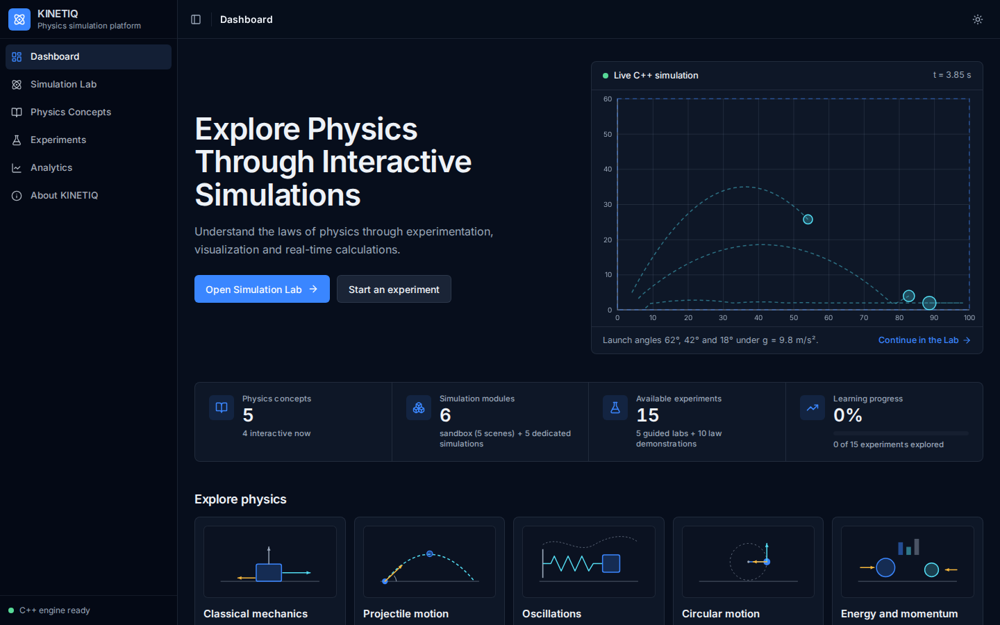
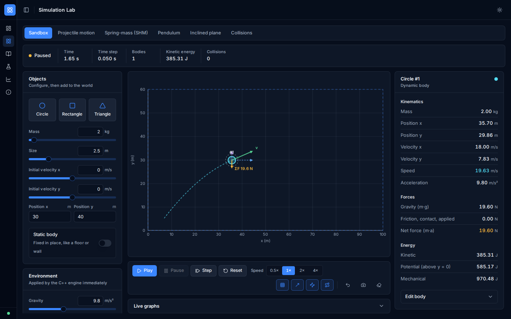
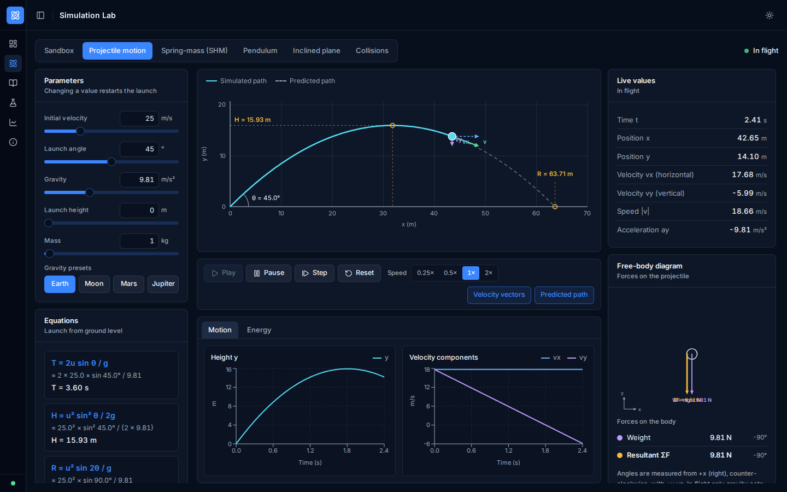
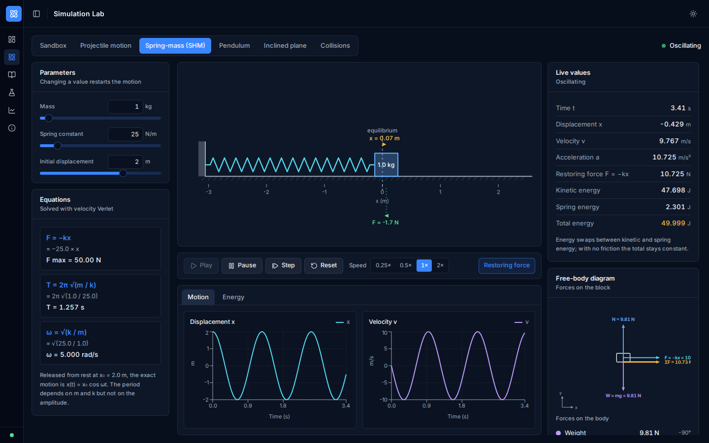
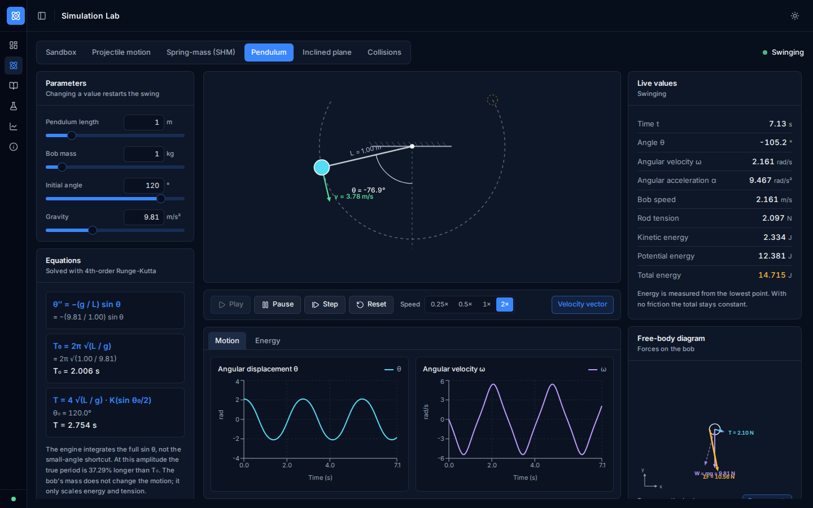
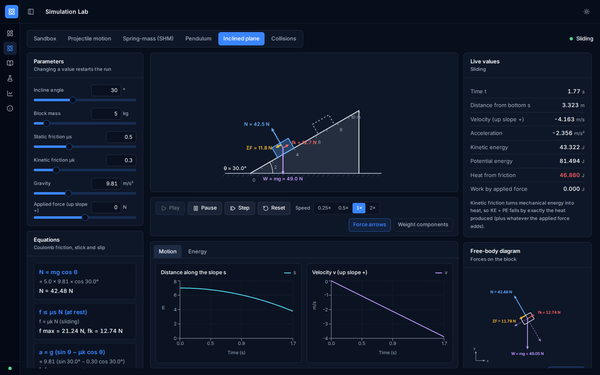
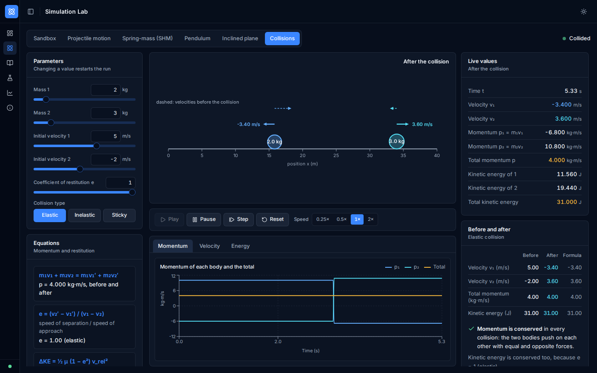
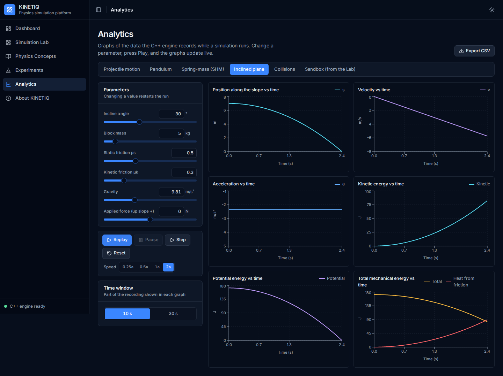
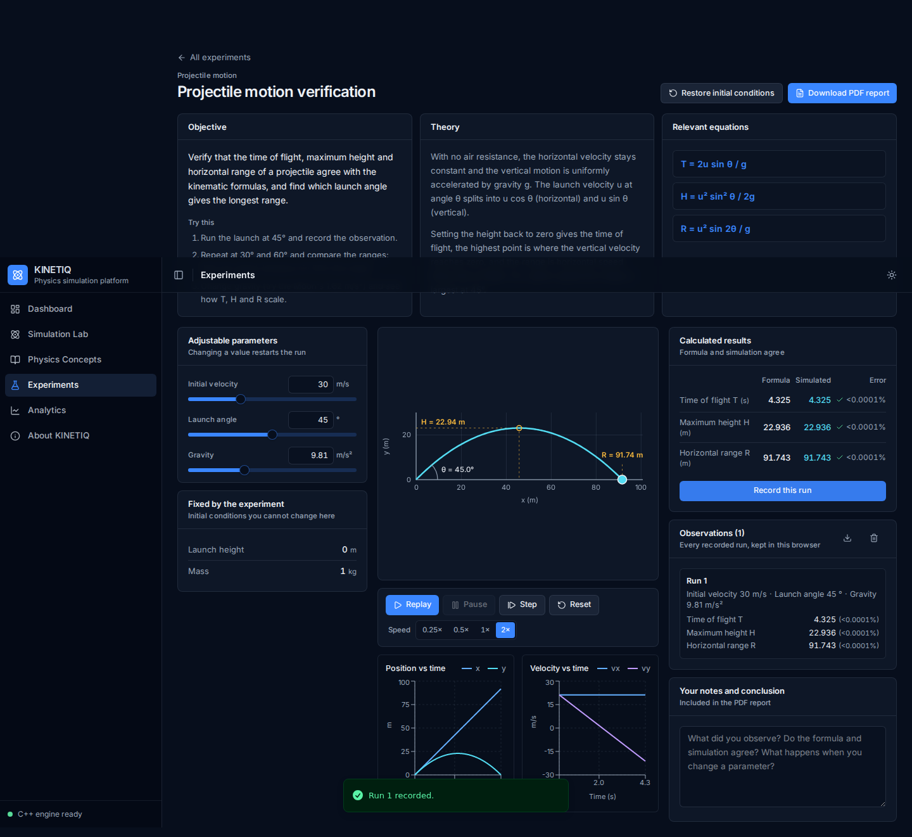
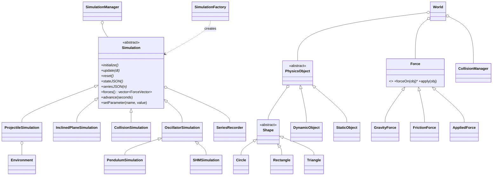

# KINETIQ: Interactive Physics Simulation and Learning Platform

KINETIQ is a 2D physics simulation and learning platform. A **C++ physics engine**, compiled to
**WebAssembly**, does all of the physics. A **React + TypeScript** interface turns it into a lab you can
experiment in: build bodies, launch projectiles, swing pendulums, slide blocks down ramps, collide
objects, read live graphs, and run guided experiments that end in a PDF report.

It started as an Object-Oriented Programming course project (a sandbox with gravity, friction and
collisions) and has been extended into a platform with five dedicated simulations, free-body diagrams,
energy and momentum analysis, analytics with CSV export, and guided experiments, **without replacing
the original engine**: the sandbox, its API and its scenes still work.



> The hero on the dashboard is the real engine: three projectiles launched by the WebAssembly world.
> Nothing on this page is animated in JavaScript.

---

## Features

**Simulation Lab** (`/lab`)
- **Sandbox**: add circles, rectangles and triangles (static or dynamic) with chosen mass, size and initial
  velocity; drag bodies; set gravity, friction, time step and the two restitution coefficients; step,
  pause, reset to the start of the run, undo; five ready-made scenes. A physics inspector shows mass,
  position, velocity, acceleration, net force and kinetic, potential and mechanical energy.
- **Projectile motion**: speed, angle, gravity (Earth/Moon/Mars/Jupiter presets), launch height and mass.
  Shows `T = 2u sinθ / g`, `H = u² sin²θ / 2g`, `R = u² sin 2θ / g` with your numbers substituted, a predicted
  and a simulated path, and a formula-versus-simulation table.
- **Spring-mass (simple harmonic motion)**: mass, spring constant and initial displacement; `F = −kx`,
  `T = 2π√(m/k)`, displacement and velocity graphs.
- **Pendulum**: length, bob mass, initial angle (to ±170°) and gravity; the *nonlinear* equation is solved
  with RK4, so large swings show their longer period (compared with the exact elliptic-integral value).
- **Inclined plane**: angle, mass, static and kinetic friction, gravity and an applied force; normal force,
  weight components, friction (stick/slip), resultant and acceleration.
- **Collisions**: two bodies with chosen masses, velocities and coefficient of restitution; Elastic /
  Inelastic / Perfectly-inelastic presets and a before/after table.
- **Free-body diagrams** for every module, and for the selected sandbox body: weight, normal, friction,
  applied, tension and spring forces, resultant and (dashed) components, in one consistent coordinate
  system (x right, y up).
- **Energy and momentum**: live KE / PE / total energy for every module with a verdict on whether
  mechanical energy is conserved (and why), plus total momentum for the sandbox and collisions.

**Analytics** (`/analytics`): position, velocity, acceleration, kinetic, potential and total mechanical
energy against time for each simulation, with units, tooltips, legends and a time window. **Export CSV**
writes the complete recording, with units in the header.

**Experiments** (`/experiments`): five guided experiments (projectile verification, conservation of
mechanical energy, elastic and inelastic collision, simple harmonic motion, friction on an inclined
plane). Each has an objective, theory, equations, initial conditions, adjustable parameters, the live
simulation, calculated results (formula against simulation), recorded observations and notes, and a
**PDF report** (parameters, results, observations and graphs). The ten original Newton's-law
demonstrations are kept under `/experiments/laws`.

**Physics Concepts** (`/concepts`): the original formula library (23 equations with explanations).

**Dashboard**: real counts, "Recently explored" and "Learning progress" (stored in the browser).

---

## Screenshots

| | |
|---|---|
|  **Sandbox lab**: inspector, forces, trajectory |  **Projectile motion** |
|  **Spring-mass (SHM)** |  **Pendulum at a large angle** |
|  **Inclined plane with forces** |  **Collisions** |
|  **Analytics** |  **Guided experiment** |

More: [experiments hub](docs/screenshots/09-experiments.png) ·
[formula library](docs/screenshots/11-concepts.png) · [light theme](docs/screenshots/12-light-theme.png)

---

## Technologies

| Layer | Technology |
|---|---|
| Physics engine | C++17, STL, no third-party libraries |
| Browser bridge | Emscripten → WebAssembly, Embind |
| Frontend | React 19, TypeScript (strict), TanStack Start / Router, Vite |
| UI | Tailwind CSS 4, shadcn/ui (Radix), Lucide icons, Inter (self-hosted) |
| Charts | Recharts (live graphs); a canvas renderer for the PDF's print-ready graphs |
| Reports | jsPDF (loaded only when a report is requested) |
| Tests | C++ assertion suite (`make test`); Playwright end-to-end suite (`e2e/`) |

---

## Architecture

```text
┌───────────────────────────────────────────────────────────────┐
│  React + TypeScript                                           │
│  Dashboard · Lab · Concepts · Experiments · Analytics         │
│  canvases draw from a per-frame feed; panels refresh at 10 Hz │
└───────────────────────────────┬───────────────────────────────┘
                                │  commands in, JSON snapshots out
┌───────────────────────────────▼───────────────────────────────┐
│  WebAssembly (Emscripten, Embind)   physics_engine.wasm / .js │
│  WebAPI facade: sandbox functions + sim* functions            │
└───────────────────────────────┬───────────────────────────────┘
                                │
┌───────────────────────────────▼───────────────────────────────┐
│  C++ engine                                                   │
│  Sandbox:  PhysicsEngine → World → PhysicsObject, Force,      │
│            CollisionManager                                   │
│  Labs:     Simulation (abstract) → 5 experiments              │
│  Shared:   FreeBodyDiagram, SeriesRecorder, Environment       │
└───────────────────────────────────────────────────────────────┘
```

**Principle: all physics is calculated in C++.** The browser sends commands (set a parameter, advance by
this much time) and reads back JSON snapshots. It never integrates equations, and formula values shown
next to simulated values are computed by the engine as well. The few display-only conversions (pixels,
unit formatting, a percentage difference) are the only arithmetic in TypeScript. See
[docs/WASM_API.md](docs/WASM_API.md) for the full interface.

### The C++ class structure



### How a frame works

1. **Fixed timestep.** `Simulation::advance(seconds)` accumulates real time and calls `update(1/240 s)` a
   whole number of times, so results do not depend on the display's frame rate (and one frame is clipped
   at 0.25 s so a hidden tab cannot cause a burst of catch-up steps). The sandbox keeps its original
   `dt` (default 0.05 s), which is adjustable.
2. **Integration**, chosen per problem:

| Simulation | Method | Why |
|---|---|---|
| Sandbox | Semi-implicit Euler (original engine) | Simple, stable for the interactive world |
| Projectile | Velocity Verlet + exact landing instant | Exact for constant acceleration |
| Spring-mass | Velocity Verlet with substeps | Symplectic: energy stays bounded |
| Pendulum | RK4 (`rk4Step<N>` template) with substeps | Nonlinear equation; negligible energy drift |
| Incline | Exact constant-acceleration kinematics, split at stick/slip and at the ends | Friction regime changes mid-step |
| Collision | Exact free flight, analytic impulse at the contact instant | Contact time independent of timestep |

3. **Rendering.** The animation loop writes each snapshot into a ref and notifies canvases directly;
   React state (inspector, readouts, graphs) refreshes at 10 Hz, graphs at 5 Hz and decimated to ≤360
   points. In a production-mode build every page holds ~60 fps, including 40 bodies and six live graphs.

---

## OOP concepts implemented

Each use has a purpose; none were added for show.

| Concept | Where | Purpose |
|---|---|---|
| **Abstraction** | `Shape`, `PhysicsObject`, `Force`, `Simulation` (pure virtual methods) | Callers work with the interface: `SimulationManager` runs any experiment without knowing which |
| **Inheritance** | `Circle/Rectangle/Triangle : Shape`; `DynamicObject/StaticObject : PhysicsObject`; `GravityForce/FrictionForce/AppliedForce : Force`; `Projectile/InclinedPlane/Collision : Simulation`; `Pendulum/SHM : OscillatorSimulation : Simulation` | Shared behaviour once; the oscillator layer owns period measurement |
| **Runtime polymorphism** | `World` applies every `Force` through `forceOn()`; each simulation implements its own `update()`; `SimulationFactory` returns `unique_ptr<Simulation>` | One loop drives different physics |
| **Encapsulation** | Private state with validated setters (`setLaunchSpeed`, `setStaticFriction`, ...); parameter ranges declared once in `parameterSpecs()`; exception hierarchy (`Exceptions.h`) | Invalid states cannot be constructed; rejected changes leave the old value |
| **Composition** | `PhysicsObject` has a `Shape`; `World` owns objects, forces and the collision manager; simulations own an `Environment` and a `SeriesRecorder`; `SimulationManager` owns the active simulation | "Has-a" relationships for structure that is not an "is-a" |
| **Operator overloading** | `Vector2D`: `+ - * /`, unary `-`, `scalar * v`, `+= -= *= /=`, `== !=`, `<< >>`, plus `dot`, `cross`, `rotated` | Vector maths reads like the equations |
| **Templates** | `ObjectManager<T>`, `TimeSeries<T>` (bounded ring buffer), `rk4Step<N, Derivative>`, `clampValue<T>` | Generic containers and integrators reused across types |
| **Template Method** | `Simulation::advance()` / `setParameter()`, `Force::apply()` | The fixed-step loop, validation and application are written once; subclasses supply the hooks |
| **Factory / Facade** | `SimulationFactory`; `WebAPI` | One place to add an experiment; one narrow door to JavaScript |

---

## Installation

**Prerequisites:** Node.js 20.19+ (or 22.12+) and npm. For the C++ tests, g++ with C++17. To rebuild the WebAssembly
engine, the [Emscripten SDK](https://emscripten.org/docs/getting_started/downloads.html) (`emcc`).

### Run the web app

```bash
cd frontend
npm install
npm run dev          # http://localhost:5173
```

The compiled engine (`frontend/public/physics_engine.js` and `.wasm`) is included, so the app runs
without Emscripten.

### Build and test the C++ engine

```bash
cd backend
make                 # console application  -> bin/physics_engine
make test            # unit tests (14 916 checks)
make run             # run the console application
make web             # recompile to WebAssembly (needs emcc); copies the result to ../frontend/public
```

`make web` uses `build_web.sh`. If you add a `.cpp` file, add it to that script's source list.

### Production build and checks

```bash
cd frontend
npm run build        # production build
npx tsc --noEmit     # type-check
npm run lint         # ESLint + Prettier
```

### End-to-end tests

```bash
pip install playwright && playwright install chromium
cd frontend && npm run dev                     # in one terminal
python3 e2e/smoke_test.py                      # in another: 43 checks against hand-calculated values
python3 e2e/capture_screenshots.py             # regenerates docs/screenshots
```

The PDF content check uses `pdftotext` (poppler) when it is installed.

---

## Testing and verification

- **C++ (`backend/tests/test_main.cpp`, `make test`)**: 14,916 checks, no framework needed. They compare the
  simulations with analytic solutions: projectile T, H, R over 420 parameter combinations; SHM period and
  energy; pendulum period against the exact elliptic-integral value from 5° to 170° and RK4 energy
  conservation; incline kinematics, the critical angle, stick/slip and energy bookkeeping; collision
  formulas for every mass ratio and restitution; free-body diagram sums (`ΣF = ma`); numeric edge cases and
  validation. Several tests were *mutation-checked*: reintroducing the original collision bugs fails
  243 and 1 checks respectively.
- **Browser (`e2e/smoke_test.py`)**: 43 checks that load every page without console errors and read numbers
  back from the UI (for example `T = 3.60 s`, `v₁′ = −3.40 m/s`, PDF text, CSV header).
- **Static**: strict TypeScript, ESLint with the project's Prettier config (0 errors).

### Bugs found in the original engine

Fixed:

1. Collisions between two dynamic bodies divided the impulse by 2 instead of by `1/mA + 1/mB`, so
   **momentum was not conserved for unequal masses** (a 1 kg body hitting a 9 kg body turned a total
   momentum of 10 into 74).
2. A dynamic body hitting a **static** body created *first* passed straight through (inverted sign); the
   other creation order worked.

Restitution (previously fixed at 0.6 for bodies and 0.7 for walls) is now configurable; the defaults are
unchanged, so existing scenes behave as before.

Found and deliberately left alone (see Known limitations): the sandbox friction law uses a constant 9.8
instead of the gravity setting, and its undo history is unbounded.

---

## Project structure

```text
backend/                    C++ engine
  include/, src/            classes (see the diagram above)
  tests/test_main.cpp       unit tests          (make test)
  build_web.sh, Makefile    WebAssembly and native builds
  web/, mini_physics_engine.html   the original standalone page (kept)
frontend/                   React app
  public/physics_engine.*   compiled engine
  src/routes/               pages (dashboard, lab, labs, analytics, experiments, concepts, about)
  src/components/           canvases, panels, charts, shell, shadcn/ui
  src/lib/physics/          engine bridge, hooks, scenes
  src/lib/experiments/      experiment definitions, observations, PDF report
e2e/                        Playwright smoke tests and screenshot script
docs/                       WebAssembly API reference, screenshots
```

**Keyboard shortcuts** on the lab pages: `Space` play/pause, `N` step, `R` reset.

---

## Known limitations

- Triangle and rectangle collisions in the sandbox still use bounding circles (as documented in the
  original code); the dedicated collision module is one-dimensional and uses discs.
- The sandbox friction law is the original `μ m·9.8` (it does not follow the gravity slider), and it has
  no springs, pendulum constraints or contact (normal-force) model; the dedicated modules cover that
  physics. Wall bounces and collisions are impulses, so they are not drawn in the sandbox free-body
  diagram.
- The sandbox keeps its original semi-implicit Euler integrator, so energy drifts by a few percent in
  frictionless runs at `dt = 0.05`; the dedicated simulations use the more accurate methods above.
- Observations, notes, "recently explored" and progress are stored in the browser's `localStorage`.
- The PDF's built-in font has no Greek letters, so equations in reports are written in ASCII
  (`theta`, `mu_s`).
- Not verified here: Safari and Firefox (tested in Chromium).

## Future scope

- Sandbox springs, pendulum constraints and joints; rotation and angular momentum (torque, moment of
  inertia); proper polygon collision (SAT).
- Circular motion and orbital simulations (the dashboard card is marked *Planned*).
- Air resistance and damping, with a damped-oscillator experiment.
- Two-dimensional collisions in the dedicated module; shareable experiment links.
- Saving and loading scenes and observations to a file or account; a teacher view for collecting reports.
- More experiments (Hooke's law, momentum in two dimensions), and automated visual regression tests.
