<div align="center">

# KINETIQ

### Interactive 2D Physics Simulation & Learning Platform

*A C++17 Object-Oriented Physics Engine compiled to WebAssembly, paired with a modern React 19 + TypeScript laboratory.*

[](backend/)
[](backend/build_web.sh)
[](frontend/)
[](frontend/)
[](frontend/)
[](backend/tests/test_main.cpp)
[](e2e/smoke_test.py)

[Overview](#overview) · [Features](#features) · [Screenshots](#screenshots) · [Architecture](#architecture) · [OOP Design](#object-oriented-programming-oop-design) · [Getting Started](#getting-started) · [Testing](#testing--verification)

<br />

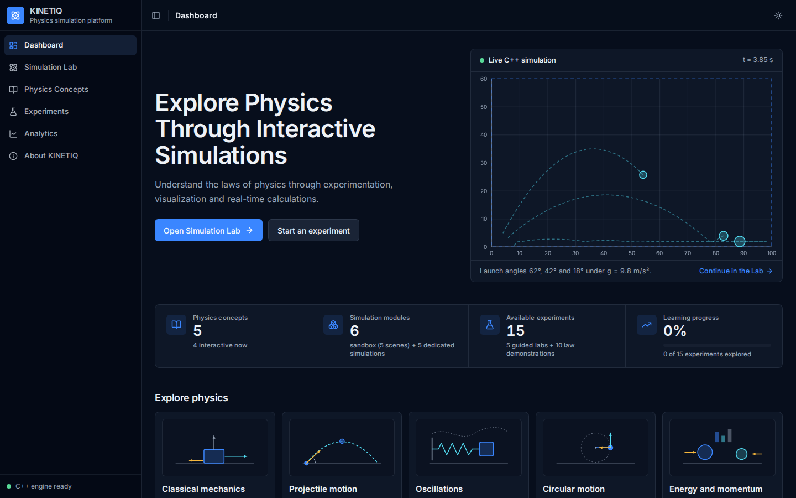

> *The hero animation on the dashboard is powered directly by the C++ WebAssembly engine—three live projectiles simulated under gravity, with zero physics computed in JavaScript.*

</div>

---

## Table of Contents

- [Overview](#overview)
- [Features](#features)
  - [Simulation Lab (10 Modules)](#1-simulation-lab-10-modules)
  - [Guided Experiments & PDF Reports](#2-guided-experiments--pdf-reports-experiments)
  - [Analytics Hub & CSV Export](#3-analytics-hub--csv-export-analytics)
  - [Physics Concepts & Formula Library](#4-physics-concepts--formula-library-concepts)
  - [Dashboard, Themes & Feedback](#5-dashboard-themes--feedback)
- [Screenshots](#screenshots)
- [Tech Stack](#tech-stack)
- [Architecture](#architecture)
  - [Three-Tier System Flow](#three-tier-system-flow)
  - [C++ Class Hierarchy](#c-class-hierarchy)
  - [Frame Loop & Numerical Integrators](#frame-loop--numerical-integrators)
- [Object-Oriented Programming (OOP) Design](#object-oriented-programming-oop-design)
- [Getting Started](#getting-started)
  - [Prerequisites](#prerequisites)
  - [1. Run the Web Application](#1-run-the-web-application)
  - [2. Environment Variables (Optional Feedback Form)](#2-environment-variables-optional-feedback-form)
  - [3. Build & Test the C++ Physics Engine](#3-build--test-the-c-physics-engine)
  - [4. Production Build & Code Quality](#4-production-build--code-quality)
  - [5. End-to-End Tests & Screenshot Automation](#5-end-to-end-tests--screenshot-automation)
- [Keyboard Shortcuts](#keyboard-shortcuts)
- [Testing & Verification](#testing--verification)
- [Project Structure](#project-structure)
- [Known Limitations](#known-limitations)
- [Roadmap](#roadmap)

---

## Overview

**KINETIQ** is an interactive 2D physics simulation and educational laboratory built on a strict separation of concerns:

- **100% of physics runs in C++17** compiled to **WebAssembly** via Emscripten. The C++ engine handles numerical integration, collision resolution, free-body force decomposition, energy and momentum accounting, and analytic formula calculations.
- **React 19 + TypeScript** acts strictly as an interactive visualization and telemetry layer—rendering 60 fps HTML5 canvases, driving transport controls, plotting decimated Recharts graphs, and exporting CSV datasets and formatted PDF lab reports.

Originally built as an Object-Oriented Programming (OOP) course project (a multi-body 2D sandbox with gravity, friction, and collisions), KINETIQ has been expanded into a complete learning platform featuring **10 simulation modules**, **5 guided experiments**, **10 Newton's law demonstrations**, and a **23-formula physics reference library**—while keeping the original sandbox engine, API, and preset scenes fully intact.

---

## Features

### 1. Simulation Lab (10 Modules)

Accessible from `/lab` and dedicated lab routes, every module provides real-time parameter controls, live readouts, energy/momentum tracking, and interactive canvas rendering:

| Module | Route | Highlights & Physics Covered |
|---|---|---|
| **Interactive Sandbox** | `/lab` | Create dynamic or static circles, rectangles, and triangles with custom mass, size, position, and initial velocity; drag bodies directly on canvas; tune gravity, friction, time step (`dt`), body & wall restitution; undo/reset; 5 preset scenes (*Free Fall*, *Collision Lab*, *Friction Test*, *Projectile Motion*, *Empty World*); live Physics Inspector & Free-Body Diagram overlays. |
| **Projectile Motion** | `/lab/projectile` | Adjustable speed, launch angle (`0–90°`), launch height, mass, and planetary gravity presets (*Earth, Moon, Mars, Jupiter*). Compares simulated trajectory against analytic $T = \frac{2u\sin\theta}{g}$, $H = \frac{u^2\sin^2\theta}{2g}$, and $R = \frac{u^2\sin 2\theta}{g}$. |
| **Spring-Mass (SHM)** | `/lab/shm` | Hooke's law oscillator ($F = -kx$) with adjustable mass, spring constant $k$, and initial displacement; real-time period $T = 2\pi\sqrt{m/k}$, phase, displacement, velocity, and energy tracking. |
| **Nonlinear Pendulum** | `/lab/pendulum` | Adjustable length, bob mass, gravity, and large initial angles up to $\pm 170^\circ$. Solves the full nonlinear equation via 4th-order Runge-Kutta (RK4) and compares period against the exact complete elliptic integral $T = 4\sqrt{L/g}\,K(\sin^2(\theta_0/2))$. |
| **Inclined Plane** | `/lab/incline` | Adjustable ramp angle (`0–80°`), mass, static ($\mu_s$) and kinetic ($\mu_k$) friction, gravity, and applied force. Resolves normal force, weight components, stick/slip threshold ($\tan\theta_c = \mu_s$), and friction heat work. |
| **1D Collisions** | `/lab/collision` | Two-body track with configurable masses, velocities, and coefficient of restitution $e \in [0, 1]$. Includes *Elastic*, *Inelastic*, and *Perfectly Inelastic* presets with a before/after momentum and kinetic energy comparison table. |
| **Circular Motion** | `/lab/circular` | Uniform and non-uniform circular motion with adjustable mass, radius, tangential speed $v$, and angular acceleration $\alpha$. Tracks $\omega = v/r$, $a_c = v^2/r$, $F_c = m a_c$, period, and frequency. |
| **Rotational Dynamics** | `/lab/rotational` | Rigid-body rotation under applied torque ($\tau = r F \sin\theta$, $\tau = I\alpha$) across **7 selectable geometries** (*Solid Disc, Solid Cylinder, Solid Sphere, Hollow Sphere, Thin Ring, Thin Rod about Center, Thin Rod about End*) with angular momentum $L = I\omega$, rotational kinetic energy, and power. |
| **Air Resistance & Drag** | `/lab/drag` | Supports both **1D vertical free-fall** and **2D projectile motion** under *No Drag*, *Linear (Stokes) Drag* ($F_d = bv$), and *Quadratic Drag* ($F_d = \frac{1}{2}\rho C_d A v^2$). Computes terminal velocity $v_t$ and Reynolds number $\text{Re}$. |
| **Orbital Mechanics** | `/lab/orbital` | Two-body Newtonian gravitation ($F = GMm/r^2$) around **5 selectable central bodies** (*Earth, Moon, Mars, Jupiter, Sun*). Computes circular orbital velocity $v_{\text{circ}} = \sqrt{GM/r}$, escape velocity $v_{\text{esc}} = \sqrt{2GM/r}$, orbital period, altitude, specific energy, and angular momentum. |

**Cross-cutting Lab Capabilities:**
- **Free-Body Diagrams (FBD):** Live vector overlays for weight, normal, friction, applied, tension, spring, and resultant forces (plus dashed components) in a consistent coordinate system (`+x` right, `+y` up).
- **Energy & Momentum Accounting:** Real-time kinetic, potential, and total mechanical energy with conservation verdicts, plus system momentum tracking.

### 2. Guided Experiments & PDF Reports (`/experiments`)

- **5 Structured Laboratory Experiments:**
  1. *Projectile Motion Verification*
  2. *Conservation of Mechanical Energy*
  3. *Elastic and Inelastic Collisions*
  4. *Simple Harmonic Motion*
  5. *Friction on an Inclined Plane*
- Each experiment includes an objective, theory, key equations, initial conditions, adjustable live parameters, a **Formula vs. Simulation** comparison table with percentage error, **Record this run** logging (persisted in `localStorage`), and student conclusion notes.
- **One-Click PDF Lab Report (`jsPDF`):** Generates a multi-page academic report with experiment metadata, parameters, results table, observations, student notes, and print-ready canvas graphs.
- **Newton's Laws Demonstrations (`/experiments/laws`):** 10 curated sandbox demonstrations illustrating Newton's 1st, 2nd, and 3rd laws, momentum conservation, kinetic friction, impulse-momentum theorem, and collision chains.

### 3. Analytics Hub & CSV Export (`/analytics`)

- Plot up to **6 synchronized live Recharts graphs** for any simulation module or the sandbox (position, velocity, acceleration, kinetic energy, potential energy, total mechanical energy, and friction dissipation).
- Adjustable time windows (`10 s`, `30 s`), interactive tooltips, units, and legends.
- **Export CSV:** Downloads the full recorded time-series dataset with SI units included in column headers.

### 4. Physics Concepts & Formula Library (`/concepts`)

- **23 interactive formula reference cards** organized across *Kinematics*, *Dynamics*, *Momentum*, *Work & Energy*, and *Gravitation*.
- Each entry displays the equation, physical meaning, when to apply it, and a variable breakdown table with SI units and dimensional formulas (e.g., $[LT^{-1}]$).

### 5. Dashboard, Themes & Feedback

- **Dashboard (`/`):** Live C++ hero simulation, auto-derived catalog counters, browser-persisted *Learning Progress* tracker, and *Recently Explored* shortcuts.
- **Dark & Light Themes:** Seamless theme toggling across all canvases, charts, and panels.
- **About & Feedback (`/about`):** Architecture summary, OOP reference, keyboard shortcuts, and an integrated 5-star user feedback form backed by Supabase.

---

## Screenshots

### Core Laboratory Views

| Interactive Sandbox Lab | Projectile Motion Lab |
| :---: | :---: |
| 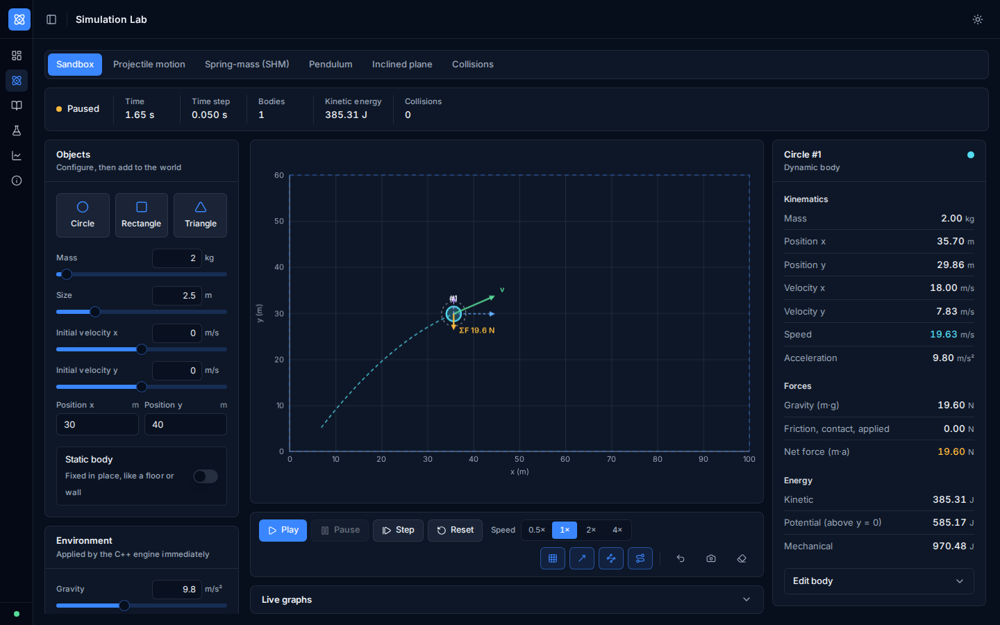 | 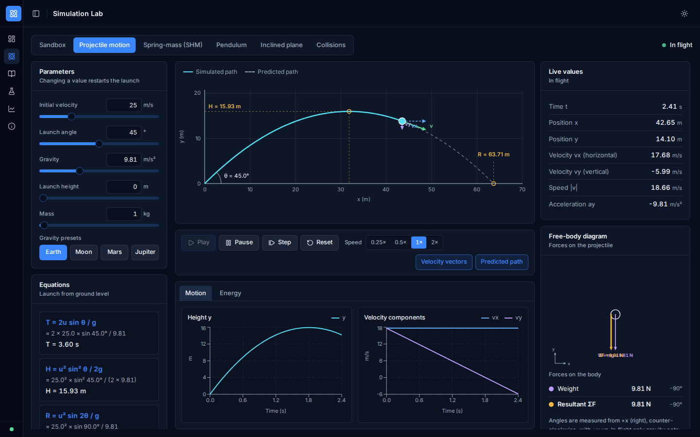 |
| *Multi-body sandbox with live inspector, force vectors, and trajectory* | *Analytic vs. simulated parabola with planetary gravity presets* |

| Spring-Mass (SHM) Lab | Nonlinear Pendulum Lab |
| :---: | :---: |
| 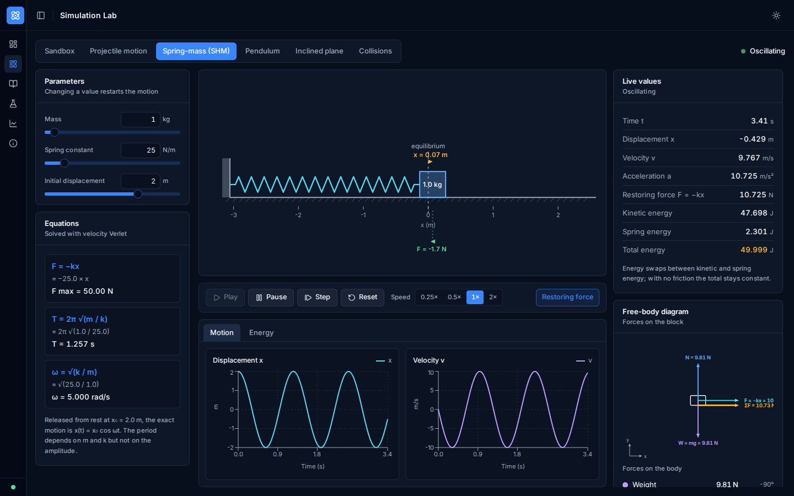 | 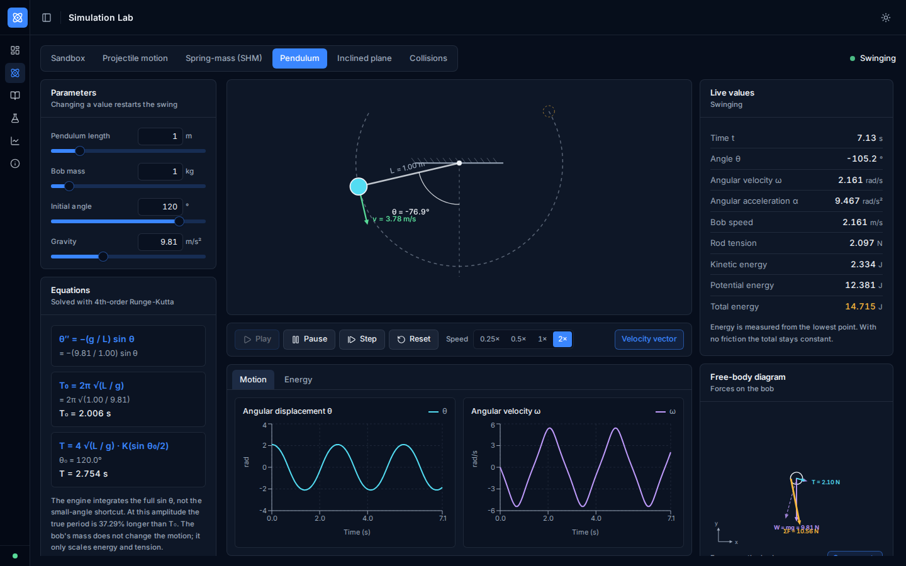 |
| *Hooke's law oscillator with live displacement and velocity telemetry* | *Large-angle RK4 integration compared against exact elliptic integral* |

| Inclined Plane Lab | 1D Collisions Lab |
| :---: | :---: |
| 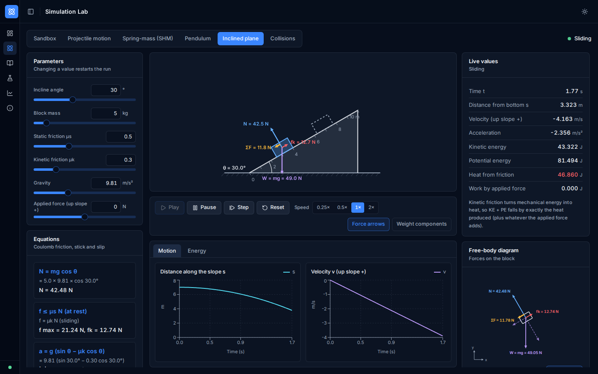 | 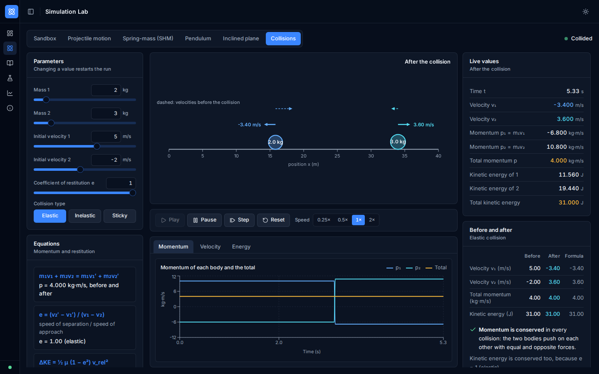 |
| *Free-body force decomposition with static/kinetic stick-slip analysis* | *Elastic & inelastic collisions with before/after momentum breakdown* |

### Analytics, Guided Experiments, Formula Library & Light Theme

| Live Telemetry Analytics | Guided Experiment & PDF Report |
| :---: | :---: |
| 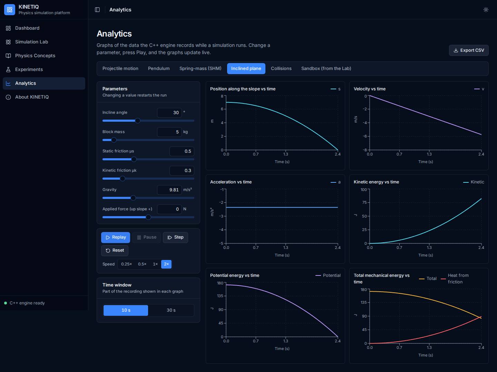 | 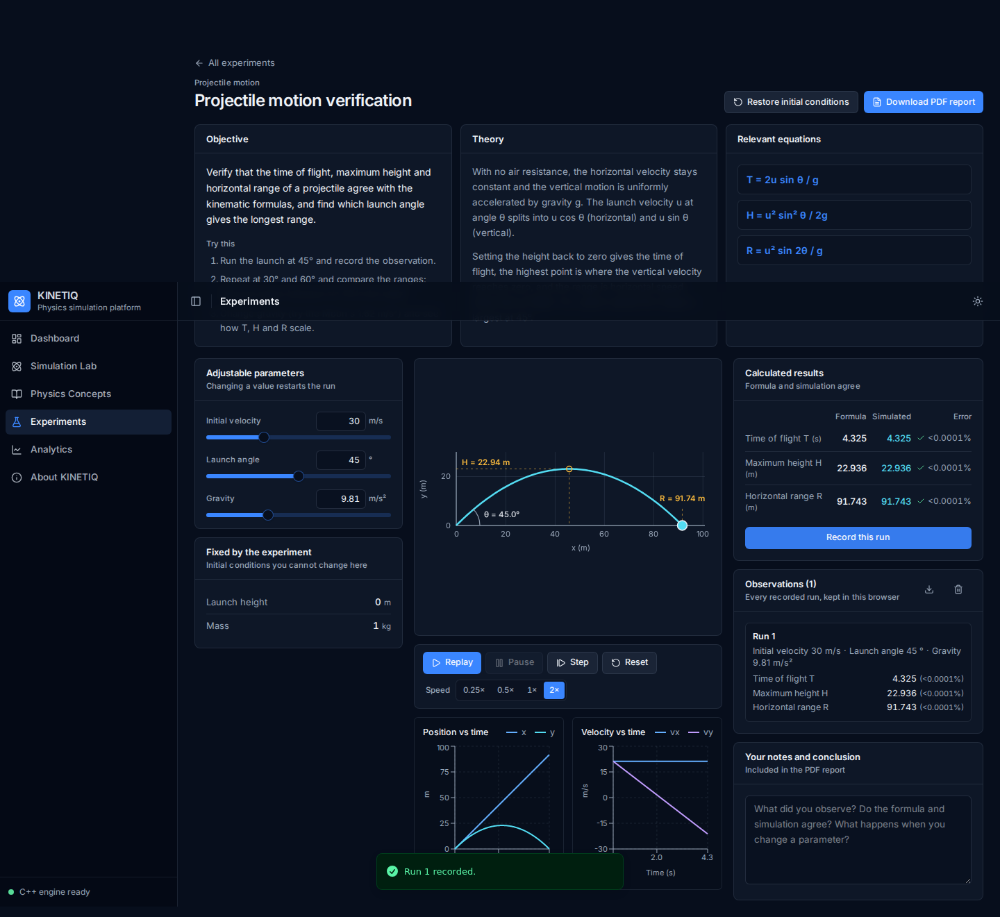 |
| *6 synchronized live time-series graphs with one-click CSV export* | *Structured lab runner with formula vs. measured table & PDF export* |

| Guided Experiments Hub | Physics Concepts (23 Formulas) |
| :---: | :---: |
| 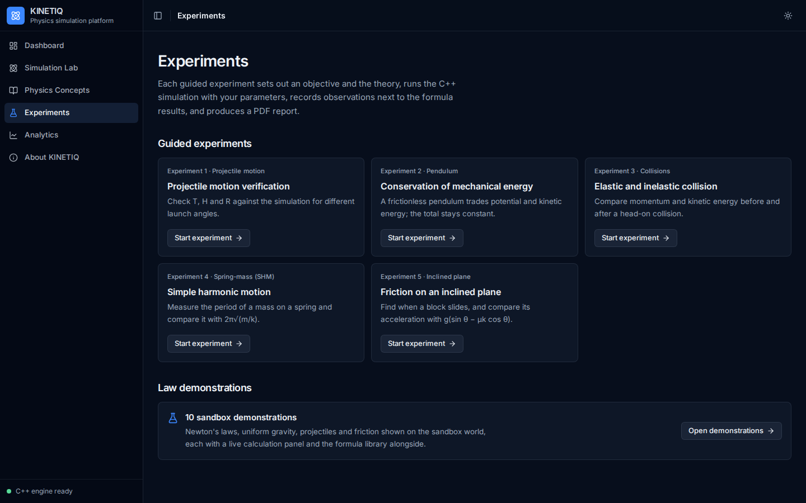 | 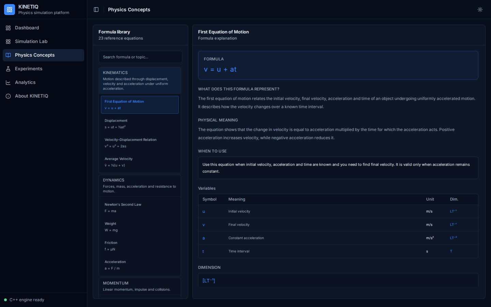 |
| *5 guided experiments + 10 interactive Newton's law demonstrations* | *Categorized reference cards with SI units and dimensional formulas* |

<details>
<summary><strong>View Light Theme Dashboard Screenshot</strong></summary>
<br />

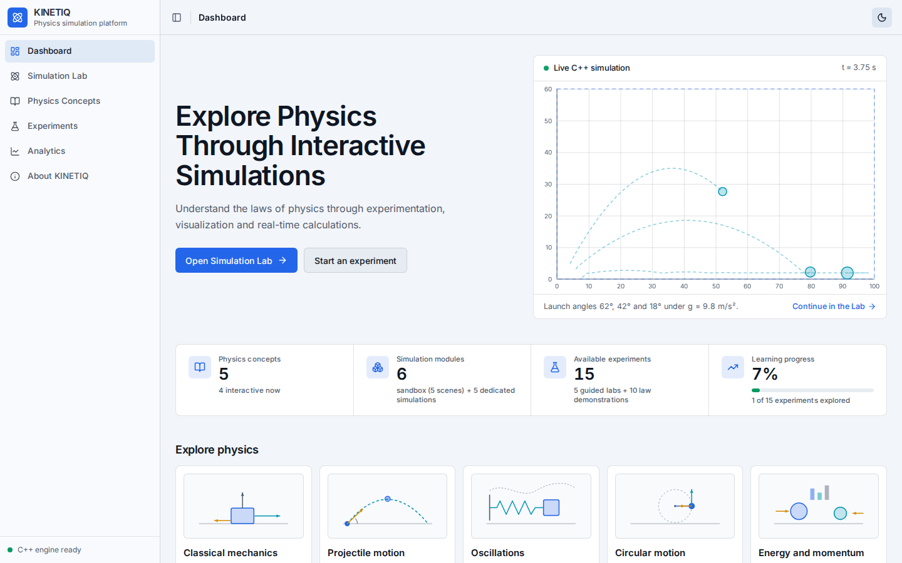

</details>

---

## Tech Stack

| Layer | Technologies | Notes |
|---|---|---|
| **Physics Engine** | C++17, Standard Template Library (STL) | Zero external C++ dependencies; custom integrators & analytic solvers |
| **WebAssembly Bridge** | Emscripten (`em++`), Embind | `WebAPI` facade compiled to `physics_engine.js` & `physics_engine.wasm` |
| **Frontend Framework** | React 19, TypeScript 5.8 (strict), TanStack Start / Router, Vite 8, Nitro | File-based routing (`routeTree.gen.ts`), fast SPA/SSR hybrid |
| **UI & Styling** | Tailwind CSS 4, Radix UI (`@radix-ui/*`), shadcn/ui, Lucide Icons, Inter | Accessible components, technical HUD aesthetics, dark & light themes |
| **Visuals & Charts** | HTML5 Canvas, Recharts | `requestAnimationFrame` canvas rendering; 10 Hz inspector / 5 Hz charts |
| **Reporting & Export** | jsPDF (lazy-loaded), CSV Exporter | Multi-page PDF lab reports with canvas graphs; SI-annotated CSV exports |
| **Persistence & Feedback** | Browser `localStorage`, Supabase (`@supabase/supabase-js`) | Local progress/observations persistence; remote feedback collection |
| **Testing & Automation** | Native C++ assertion suite, Python Playwright (Chromium) | 14,916 C++ physics checks + 43 browser E2E checks + screenshot runner |

---

## Architecture

### Three-Tier System Flow

```text
┌────────────────────────────────────────────────────────────────────────┐
│  React 19 + TypeScript (TanStack Start / Router)                       │
│  Dashboard · Simulation Lab · Concepts · Experiments · Analytics      │
│  Canvases draw via requestAnimationFrame; UI panels refresh at 10 Hz   │
└───────────────────────────────────┬────────────────────────────────────┘
                                    │  Commands & parameters in, JSON snapshots out
┌───────────────────────────────────▼────────────────────────────────────┐
│  WebAssembly Bridge (Emscripten Embind)  physics_engine.js / .wasm     │
│  WebAPI facade: Sandbox API + sim* polymorphic simulation API          │
└───────────────────────────────────┬────────────────────────────────────┘
                                    │
┌───────────────────────────────────▼────────────────────────────────────┐
│  C++17 Physics Engine                                                  │
│  • Sandbox: PhysicsEngine → World → PhysicsObject, Force, Collisions  │
│  • Labs:    Simulation (abstract) → 9 concrete simulation subclasses   │
│  • Shared:  FreeBodyDiagram, SeriesRecorder, Integrators, Vector2D     │
└────────────────────────────────────────────────────────────────────────┘
```

> **Design Principle:** The browser sends commands (set parameter, advance by $\Delta t$, spawn body) and reads JSON snapshots back. Even the theoretical/formula values displayed alongside simulated measurements are computed in C++. See [`docs/WASM_API.md`](docs/WASM_API.md) for the complete WebAssembly interface specification.

### C++ Class Hierarchy

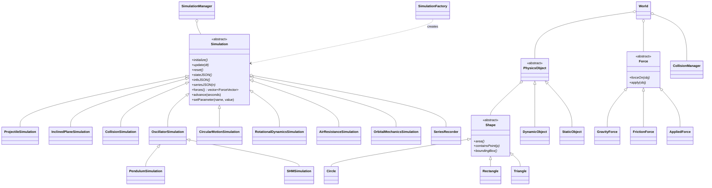

### Frame Loop & Numerical Integrators

1. **Fixed Timestep Accumulation:** `Simulation::advance(seconds)` accumulates elapsed wall time and steps `update(1/240 s)` an integer number of times (clipping frame deltas at `0.25 s` to avoid catch-up spikes when returning to a background tab). `OrbitalMechanicsSimulation` overrides `advance()` with adaptive sub-stepping for planetary timescales, while the Sandbox retains its user-configurable `dt` (default `0.05 s`).
2. **Problem-Specific Integrators:**

| Simulation | Integration Method | Rationale |
|---|---|---|
| **Sandbox** | Semi-implicit Euler | Simple and unconditionally responsive for interactive multi-body editing |
| **Projectile Motion** | Velocity Verlet + exact landing instant | Exact for constant acceleration; pinpoints exact ground contact time |
| **Spring-Mass (SHM)** | Velocity Verlet with sub-steps | Symplectic integrator keeps total mechanical energy bounded over long runs |
| **Pendulum** | 4th-Order Runge-Kutta (`rk4Step<N>`) with sub-steps | Accurately integrates nonlinear large-angle swings with negligible energy drift |
| **Inclined Plane** | Piecewise exact constant-acceleration kinematics | Analytically splits steps at static/kinetic friction transitions and track ends |
| **Collisions** | Exact free flight + analytic impulse at contact | Contact time and restitution impulse are independent of timestep size |
| **Circular Motion** | Analytic angular kinematics | Exact $\omega(t)$ and $\theta(t)$ for both uniform and accelerating circular paths |
| **Rotational Dynamics** | Velocity Verlet on $(\theta, \omega)$ | Exact constant-torque angular kinematics and rotational energy accounting |
| **Air Resistance** | Velocity Verlet (Störmer–Verlet) with sub-steps | Stable integration for both linear ($bv$) and quadratic ($\frac{1}{2}\rho C_d A v^2$) drag |
| **Orbital Mechanics** | Velocity Verlet (Leapfrog) with adaptive sub-steps | Symplectic energy & angular momentum preservation across elliptical/escape orbits |

3. **Decoupled Rendering:** The animation loop stores snapshots in a mutable ref and repaints HTML5 canvases directly at 60 fps, while React UI panels refresh at 10 Hz and Recharts plots update at 5 Hz (decimated to $\le 360$ points).

---

## Object-Oriented Programming (OOP) Design

Every OOP pillar and design pattern in the C++ codebase serves a concrete architectural purpose:

| Concept | Implementation in KINETIQ | Purpose |
|---|---|---|
| **Abstraction** | Pure virtual interfaces: `Shape`, `PhysicsObject`, `Force`, `Simulation` | Callers like `SimulationManager` and `World` operate on contracts without coupling to concrete types |
| **Inheritance** | `Circle`/`Rectangle`/`Triangle` $\to$ `Shape`; `DynamicObject`/`StaticObject` $\to$ `PhysicsObject`; `GravityForce`/`FrictionForce`/`AppliedForce` $\to$ `Force`; 9 lab classes $\to$ `Simulation` (via `OscillatorSimulation` for oscillators) | Shares common behavior (e.g., period measurement in `OscillatorSimulation`) without duplication |
| **Runtime Polymorphism** | `World` iterates `vector<unique_ptr<PhysicsObject>>` and `vector<unique_ptr<Force>>`; `SimulationFactory::create()` returns `unique_ptr<Simulation>` | A single simulation loop and API facade drives 10 distinct physics domains |
| **Encapsulation & Exceptions** | Private physics state with validated mutators; declarative bounds in `parameterSpecs()`; custom hierarchy in `Exceptions.h` | Prevents invalid physical states; rejected mutations leave prior state intact |
| **Composition** | `PhysicsObject` has a `Shape`; `World` owns objects, forces, and `CollisionManager`; simulations own `SeriesRecorder` | Models clean *"has-a"* ownership using RAII smart pointers |
| **Operator Overloading** | `Vector2D` overloads `+`, `-`, `*`, `/`, unary `-`, `scalar * v`, `+=`, `-=`, `*=`, `/=`, `==`, `!=`, `<<`, `>>` | Expresses vector physics naturally alongside `dot()`, `cross()`, and `rotated()` |
| **Templates** | `TimeSeries<T>` (bounded ring buffer), `ObjectManager<T>`, `rk4Step<N, Derivative>`, `clampValue<T>` | Type-safe reusable containers and numerical solvers |
| **Template Method Pattern** | `Simulation::advance()` / `setParameter()`, `Force::apply()` | Base class enforces fixed-step loop and bounds validation; subclasses supply `update()` / `applyParameter()` |
| **Factory & Facade Patterns** | `SimulationFactory` and `WebAPI` | Single registration point for new simulations; narrow, stable Embind gateway to JavaScript |

---

## Getting Started

### Prerequisites

- **Node.js** `20.19+` (or `22.12+`) and **npm**
- **C++17 compiler** (`g++` or `clang++`) — *needed only to compile/run native C++ binaries & unit tests*
- **[Emscripten SDK](https://emscripten.org/docs/getting_started/downloads.html) (`emcc` / `em++`)** — *optional; needed only if you modify C++ code and want to rebuild WebAssembly*
- **Python 3.9+ & Playwright** — *optional; needed only for E2E tests and screenshot automation*

### 1. Run the Web Application

Pre-compiled WebAssembly binaries (`physics_engine.js` and `physics_engine.wasm`) are already bundled in `frontend/public/`, so you can launch the web app immediately without installing Emscripten:

```bash
cd frontend
npm install
npm run dev
```

Open **[http://localhost:5173](http://localhost:5173)** in your browser.

### 2. Environment Variables (Optional Feedback Form)

The `/about` page includes a Supabase-backed feedback form. Create `frontend/.env.local` with your Supabase project credentials:

```env
VITE_SUPABASE_URL=https://your-project-id.supabase.co
VITE_SUPABASE_PUBLISHABLE_KEY=your-supabase-anon-or-publishable-key
```

> **Expected Supabase table:** `feedback` with columns `rating` (int, 1–5), `category` (text), and `message` (text).

### 3. Build & Test the C++ Physics Engine

```bash
cd backend

# Build native console executable (bin/physics_engine)
make

# Run all 14,916 C++ unit & analytic verification checks
make test

# Run the native console application
make run

# Recompile C++ to WebAssembly and sync to frontend/public/ (requires emcc)
make web

# Serve the standalone HTML/WASM demo on http://localhost:8080
make serve-web
```

> **Note:** `make web` invokes `backend/build_web.sh`. If you add a new `.cpp` source file, add it to the source list in `build_web.sh`.

### 4. Production Build & Code Quality

```bash
cd frontend

npm run build        # Production bundle (Vite + Nitro)
npx tsc --noEmit     # Strict TypeScript type-check
npm run lint         # ESLint check
npm run format       # Prettier formatting
```

### 5. End-to-End Tests & Screenshot Automation

```bash
pip install playwright && playwright install chromium

# Terminal 1 — start the dev server
cd frontend && npm run dev

# Terminal 2 — run the 43 Playwright E2E checks
python3 e2e/smoke_test.py

# Regenerate all 12 screenshots in docs/screenshots/
python3 e2e/capture_screenshots.py
```

> Tip: Install `poppler` (`pdftotext`) if you want the E2E suite to inspect extracted PDF lab report text as well.

---

## Keyboard Shortcuts

Active across the Simulation Lab pages:

| Key | Action |
| :---: | :--- |
| `Space` | Play / Pause simulation |
| `N` | Step forward by one frame / timestep |
| `R` | Reset simulation to initial conditions |

---

## Testing & Verification

- **C++ Unit & Physics Suite (`backend/tests/test_main.cpp`, `make test`):**
  - **14,916 self-contained assertions** with zero external test framework dependencies.
  - Verifies projectile $T, H, R$ across 420 parameter combinations; SHM period & energy; nonlinear pendulum period vs. exact elliptic integral from $5^\circ$ to $170^\circ$; inclined-plane critical angle, stick/slip transitions & work-energy accounting; 1D collisions across mass ratios & restitution values; free-body diagram force sums ($\Sigma\mathbf{F} = m\mathbf{a}$); numeric edge cases; and exception validation.
  - Mutation-checked against historical engine bugs (reintroducing original collision bugs fails 243 and 1 checks respectively).
- **Playwright Browser E2E Suite (`e2e/smoke_test.py`):**
  - **43 end-to-end checks** loading every route with zero console errors and validating UI readouts against hand-calculated physics values (e.g., `T = 3.60 s`, `v₁′ = −3.40 m/s`, CSV headers, and PDF report contents).
- **Static Analysis:** Strict TypeScript (`tsc --noEmit`) and ESLint + Prettier with zero errors.

### Engine Bug Fixes Documented During Rework

1. **Momentum Conservation for Unequal Masses:** Fixed an impulse scaling bug in dynamic-dynamic collisions that previously divided by `2` instead of `1/mA + 1/mB` (which broke momentum conservation for unequal masses).
2. **Dynamic-Static Collision Order:** Fixed an inverted sign when a dynamic body collided with a static body created earlier in the world.
3. **Configurable Restitution:** Exposed body and wall restitution coefficients as live parameters while preserving original defaults (`0.6` and `0.7`) for backward compatibility with existing scenes.

---

## Project Structure

```text
.
├── backend/                          # C++17 Physics Engine & WebAssembly Build
│   ├── include/                      # Headers (Simulation hierarchy, Shape, Force, World, Vector2D, WebAPI)
│   ├── src/                          # C++ implementations (.cpp)
│   ├── tests/
│   │   └── test_main.cpp             # 14,916 unit & analytic physics verification checks
│   ├── web/                          # Standalone Emscripten build output
│   ├── build_web.sh                  # Emscripten (em++) compilation & sync script
│   ├── Makefile                      # Native build, test, run, and web targets
│   └── mini_physics_engine.html      # Original standalone HTML sandbox demo
├── frontend/                         # React 19 + TypeScript Web Application
│   ├── public/
│   │   ├── physics_engine.js         # Pre-built WebAssembly JS glue
│   │   └── physics_engine.wasm       # Pre-built WebAssembly binary
│   ├── src/
│   │   ├── components/               # Canvases, HUD panels, charts, FBD overlays, shadcn/ui
│   │   ├── lib/
│   │   │   ├── physics/              # WASM bridge, simulation hooks, preset scenes
│   │   │   ├── experiments/          # Guided experiment definitions, observations, PDF generator
│   │   │   ├── analyticsConfig.ts    # Chart channel & color definitions
│   │   │   ├── catalog.ts            # Module & concept registry
│   │   │   ├── export.ts             # SI-annotated CSV export utilities
│   │   │   └── supabase.ts           # Supabase client configuration
│   │   ├── routes/                   # TanStack Router file-based pages
│   │   │   ├── index.tsx             # Dashboard (/)
│   │   │   ├── lab.tsx               # Sandbox Lab (/lab)
│   │   │   ├── lab_.*.tsx            # 9 dedicated simulation labs
│   │   │   ├── analytics.tsx         # Telemetry Analytics (/analytics)
│   │   │   ├── experiments.tsx       # Guided Experiments Hub (/experiments)
│   │   │   ├── experiments_.$experimentId.tsx
│   │   │   ├── experiments_.laws.tsx # 10 Newton's Law demonstrations
│   │   │   ├── concepts.tsx          # 23-Formula Reference Library (/concepts)
│   │   │   └── about.tsx             # Architecture, OOP summary & Feedback (/about)
│   │   └── routeTree.gen.ts          # Auto-generated TanStack route tree
│   ├── package.json
│   └── vite.config.ts
├── e2e/                              # End-to-End Automated Verification
│   ├── smoke_test.py                 # 43 Playwright browser & physics checks
│   └── capture_screenshots.py        # Automated documentation screenshot generator
├── docs/
│   ├── WASM_API.md                   # Complete WebAssembly API documentation
│   └── screenshots/                  # 12 high-resolution UI screenshots
└── README.md
```

---

## Known Limitations

- **Sandbox Shapes:** Triangle and rectangle collisions in the Sandbox use bounding-circle approximations (as designed in the original engine); the dedicated Collision lab models 1D disc impacts analytically.
- **Sandbox Friction & Integrator:** The Sandbox preserves its original friction law (`μ·m·9.8`) and semi-implicit Euler integrator (`dt = 0.05 s`), which can show slight energy drift in frictionless runs; the 9 dedicated labs use higher-order / exact integrators.
- **Client-Side Persistence:** Observations, notes, recently explored links, and learning progress are stored locally in browser `localStorage`.
- **PDF Typography:** Built-in `jsPDF` fonts use ASCII notation for Greek symbols in exported PDF equations (e.g., `theta`, `mu_s`).
- **Browser Testing:** Automated E2E verification is run in Chromium (Safari and Firefox have not been formally verified in CI).

---

## Roadmap

- [ ] Separating Axis Theorem (SAT) polygon collision detection in the Sandbox
- [ ] Springs, pendulum constraints, and articulated joints inside the Sandbox
- [ ] 2D oblique collisions in the dedicated Collisions lab
- [ ] Damped harmonic oscillator & resonance guided experiment
- [ ] Shareable experiment URLs and cloud save/load for custom sandbox scenes
- [ ] Instructor dashboard for collecting and reviewing student PDF lab reports
- [ ] Automated visual regression testing across light and dark themes
